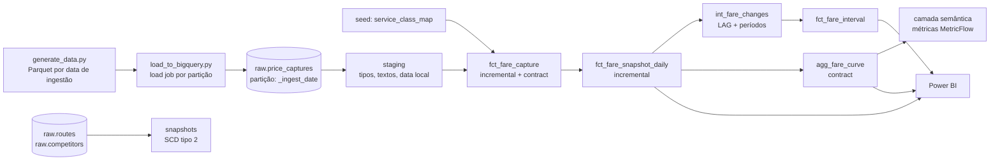

# Tarifas da Concorrência no Rodoviário - dbt + BigQuery + Power BI

Pipeline analítico para uma viação que monitora as tarifas dos concorrentes:
leva as capturas de preço para o BigQuery, modela o histórico com dbt (modelo
dimensional, carga incremental por partição, snapshots, contracts, testes de
qualidade e volume, teste unitário e camada semântica) e entrega um painel Power BI que compara a nossa tarifa com a do
mercado **na mesma antecedência**.

Os dados são sintéticos, mas reproduzem os problemas reais desse tipo de fonte:

- cada site escreve a cidade e a classe de um jeito (`SAO PAULO (TIETE)/SP`,
  `São Paulo - SP`, `SEMILEITO`, `Semi Leito`);
- o mesmo preço é capturado várias vezes, há reenvios com preço corrigido e
  capturas que chegam com dias de atraso;
- saídas esgotadas vêm sem preço, e esgotamento é informação de demanda, não
  dado ruim;
- rotas fora da nossa malha e rótulos de classe desconhecidos aparecem no meio;
- um concorrente pratica tarifa fixa, os outros fazem precificação dinâmica.

## Arquitetura



| Camada | Ferramenta | Pasta |
|---|---|---|
| Geração e ingestão | Python, PyArrow, google-cloud-bigquery | `ingestion/` |
| Transformação e testes | dbt Core + dbt-bigquery + dbt_utils | `dbt/` |
| Integração contínua | GitHub Actions | `.github/workflows/` |
| Visualização | Power BI | `powerbi/` |

## Modelagem

| Modelo | Grão | Materialização |
|---|---|---|
| `fct_fare_capture` | uma captura: concorrente, rota, saída (data e hora), classe, momento da captura | incremental, `insert_overwrite`, partição por `capture_date`, cluster por rota, data da saída e concorrente, contract |
| `fct_fare_snapshot_daily` | concorrente x rota x saída x classe x dia de captura (última captura do dia) | incremental, `insert_overwrite`, partição por `capture_date` |
| `fct_fare_interval` | período de mesma tarifa (ou de esgotamento) de uma saída | tabela, partição mensal por `departure_date` |
| `agg_fare_curve` | rota x classe x data da saída x antecedência: nossa tarifa x mercado | tabela, partição por `departure_date`, contract |
| `dim_route`, `dim_service_class`, `dim_competitor`, `dim_date` | um registro por chave | tabela |
| `snap_routes`, `snap_competitors` | uma versão de cada cadastro (SCD tipo 2) | snapshot, estratégia `check` |

Decisões principais:

- **Duas datas, um conceito central.** Toda captura tem a data da captura e a
  data da saída. A diferença entre elas é a **antecedência**, o eixo da
  precificação no rodoviário: a tarifa sobe conforme a saída se aproxima.
  Comparar a nossa tarifa com a do concorrente só faz sentido na mesma
  antecedência, e é esse o grão da `agg_fare_curve`.
- **Partição por data de captura na fato de capturas.** A carga diária toca só
  as datas capturadas. Particionar por data da saída obrigaria cada carga a
  reescrever dezenas de partições, porque o scraper consulta saídas de até 60
  dias à frente. O cluster por rota e data da saída compensa nas consultas por
  saída, e o mart de curva, que é reconstruído por inteiro, é particionado por
  data da saída, que é como o painel filtra.
- **Fato de intervalos.** O preço de uma saída muda ao longo das capturas. A
  `fct_fare_interval` guarda cada período de mesma tarifa com `valid_from` e
  `valid_to`: com os dados padrão, 2,2 milhões de linhas diárias viram 424 mil
  períodos (4,7 por saída em média). "Esgotado" é um estado próprio: a saída que
  esgota e volta a ter assento gera períodos novos.
- **Gaps and islands.** `LAG` compara o estado da tarifa com o anterior, uma
  soma acumulada das mudanças numera o período, e o `GROUP BY` no período gera o
  intervalo. Um teste unitário do dbt cobre os casos de preço que volta a um
  valor antigo e de esgotamento.
- **De-para de cidades e classes.** A grafia de cada site é convertida para a
  nossa cidade (tabela de aliases) e a nossa classe (seed versionado). O que não
  converte fica na fato de capturas, com chave nula, e gera alerta, em vez de
  sumir em silêncio.
- **Data local.** `captured_at` é TIMESTAMP (UTC). A data da captura é calculada
  em `America/Sao_Paulo`: uma captura às 22h já é o dia seguinte em UTC.
  `departure_at` é DATETIME, sem fuso, como aparece no site.
- **Dinheiro em NUMERIC**, não FLOAT.

## Carga incremental

A tabela bruta é particionada por **data de ingestão**; as fatos, por **data de
captura**. Uma captura atrasada chega numa ingestão posterior, mas pertence a
uma partição de captura antiga. Por isso o incremental não usa "linhas novas":
usa **datas de captura afetadas** (`dbt/macros/incremental_dates.sql`):

1. ponto de corte = maior data de ingestão já processada − `lookback_days` (padrão 3);
2. datas afetadas = datas de captura que receberam alguma linha a partir do corte;
3. o modelo reprocessa essas datas por inteiro, e o `insert_overwrite` substitui
   só essas partições.

As datas são calculadas antes do modelo (`run_query`) e entram no SQL como
literais. Filtros constantes garantem o partition pruning no BigQuery, o que não
acontece com uma subquery.

A carga bruta também é idempotente: cada arquivo vai para a sua partição
(`price_captures$AAAAMMDD`) com `WRITE_TRUNCATE`. Rodar de novo substitui, não
duplica.

## Qualidade

| Verificação | Onde | Severidade |
|---|---|---|
| **Contract** (nomes, tipos e not null das colunas) | `fct_fare_capture`, `agg_fare_curve` | erro no build |
| **Teste unitário** dos períodos de tarifa | `int_fare_changes` | erro |
| Grão único (`unique_combination_of_columns`) | todas as fatos e a curva | erro |
| Integridade com as dimensões | fatos | erro |
| Nenhuma captura depois da saída | `fct_fare_capture` | erro |
| Preço presente quando não está esgotado | `fct_fare_capture` | erro |
| Períodos sem sobreposição | `tests/assert_fare_intervals_do_not_overlap.sql` | erro |
| Rota fora da malha ou grafia desconhecida | `fct_fare_capture.route_id` | alerta |
| Rótulo de classe fora do seed | `fct_fare_capture.class_code` | alerta |
| Variação de tarifa acima de 50% de um dia para o outro | `tests/assert_no_extreme_fare_jump.sql` | alerta |
| Atualização da fonte (`source freshness`) | `raw.price_captures` | alerta em 2 dias, erro em 4 |
| **Schema da fonte**: colunas esperadas pelo staging (`has_expected_columns`) | `raw.price_captures` | erro |
| **Volume**: linhas do último dia completo x média dos 7 anteriores, faixa de 0,5 a 2 (`volume_vs_baseline`) | `fct_fare_capture` | alerta |

Anomalias de preço e de-paras faltando são **alerta**: podem ser feriado ou
rota nova e devem ser investigados antes de parar a carga.

Os dois testes genéricos novos ficam em `dbt/tests/generic/` e servem para
qualquer modelo. O contract protege o que publicamos; o teste de schema protege
o que recebemos; o de volume pega o scraper que parou ou o reenvio em massa, que
passam por todos os outros testes.

## Camada semântica e contexto para IA

- **Métricas** (`dbt/models/marts/_semantic.yml`, MetricFlow): tarifa média nossa
  e do mercado, índice de preço e taxas de esgotamento, definidas uma vez como
  razão de somas. A média das médias por linha dá número errado assim que se
  agrega mais de uma rota ou dia; as medidas DAX do painel usam as mesmas
  fórmulas. Decisão registrada no [ADR 0002](docs/adr/0002-metricas-na-camada-semantica.md).
- **Metadados estruturados**: cada mart declara em `meta` o grão, o dono, o SLA
  e um `ai_context` (quando usar a tabela e o erro mais provável). Termos de
  negócio ficam em doc blocks (`_docs.md`). Tudo vai para o `manifest.json`.
- **[`docs/ai-context.md`](docs/ai-context.md)**: regras para um agente (LLM)
  consultar os dados sem alucinar - qual tabela, como agregar, o que é nulo,
  qual das duas datas usar.
- **Exposures** (`_exposures.yml`): o painel aparece na linhagem do dbt docs, e
  `dbt ls --select +exposure:painel_tarifas_concorrencia` lista tudo de que ele depende.

## Padrões do time

- [`docs/convencoes-modelagem.md`](docs/convencoes-modelagem.md): camadas,
  nomes, o que toda fato precisa declarar, quando usar incremental e severidade
  dos testes.
- [`docs/adr/`](docs/adr/): decisões de arquitetura (partição da fato de
  capturas, métricas na camada semântica).

## Custo

- Carga por load job (gratuita), não por streaming.
- `require_partition_filter` na tabela bruta: nenhuma consulta lê o histórico
  inteiro sem querer.
- `maximum_bytes_billed` de 10 GB em todos os targets do dbt (`dbt/profiles.yml`).
- O Power BI lê a curva agregada, não a fato de capturas.

`dbt/analyses/custo_particao_cluster.sql` compara os bytes processados com e sem
partição e cluster, inclusive o custo da escolha da partição por data de
captura. Preencha com os números do seu projeto:

| Consulta | Bytes processados |
|---|---|
| Fato de capturas inteira | _preencher_ |
| Uma semana de captura (partição) | _preencher_ |
| Uma semana + rota e data da saída (partição + cluster) | _preencher_ |
| Curva de uma saída sem filtro de captura | _preencher_ |
| A mesma curva no mart particionado por saída | _preencher_ |

## Como rodar

### 1. Google Cloud

1. Crie um projeto no Google Cloud e ative a API do BigQuery.
2. Ative o faturamento e crie um **alerta de orçamento** baixo. O nível gratuito
   do BigQuery (1 TiB de consulta por mês e 10 GiB de armazenamento) cobre este
   projeto. No **sandbox** (sem faturamento) a carga funciona, mas os modelos
   incrementais não, porque o sandbox não permite DML (`MERGE`).
3. Autentique: `gcloud auth application-default login`.

### 2. Dados

```bash
cd ingestion
python -m venv .venv && source .venv/bin/activate   # Windows: .venv\Scripts\activate
pip install -r requirements-dev.txt
pytest -q tests

python generate_data.py --out ../data --days 180
python load_to_bigquery.py --project SEU_PROJETO --data ../data
```

Com os valores padrão: 2,47 milhões de capturas de 5 empresas em 24 rotas e 378
serviços regulares, em 183 arquivos (43 MB em Parquet). Para simular a carga
diária, use `--start` e `--end` no `load_to_bigquery.py`.

### 3. dbt

```bash
cd dbt
pip install "dbt-bigquery>=1.10,<2"
export GCP_PROJECT=SEU_PROJETO DBT_DATASET=dev DBT_PROFILES_DIR=.
dbt deps
dbt build                                  # seed + snapshots + modelos + contracts + testes
dbt build --select fct_fare_capture+       # segunda execução: caminho incremental
dbt source freshness
dbt docs generate && dbt docs serve        # documentação e linhagem
```

Os modelos ficam nos datasets `dev_staging`, `dev_intermediate`, `dev_marts` e
`dev_reference` (seed).

### 4. Power BI

Veja [`powerbi/README.md`](powerbi/README.md): conexão, modelo com a data em dois
papéis, medidas DAX e layout das páginas.

### 5. CI

O workflow `.github/workflows/ci.yml` roda em todo pull request:

1. `pytest` do gerador;
2. `dbt parse --warn-error`, que roda sempre, sem warehouse, e valida Jinja,
   refs, YAML, snapshots, exposures e o manifesto semântico;
3. `dbt build` completo num dataset temporário (`ci_<número do PR>`);
4. segunda execução dos incrementais, para validar o caminho `is_incremental()`;
5. remoção dos datasets temporários.

Para ativar o passo do dbt:
- crie uma service account com os papéis **BigQuery Data Editor** e **BigQuery Job User**;
- no GitHub, em *Settings > Secrets and variables > Actions*, crie o segredo
  `GCP_SA_KEY` (JSON da chave) e a variável `GCP_PROJECT`.

Sem a variável `GCP_PROJECT`, o CI roda os testes do gerador e o `dbt parse`.

## Próximos passos

- `fct_fare_interval` incremental por data de saída afetada, para o volume real.
- Histórico de vendas e ocupação da nossa empresa, para cruzar tarifa do mercado com demanda.
- Tempo de reação: quanto tempo o concorrente leva para responder a uma mudança nossa.
- Slim CI com `state:modified+` comparando com o manifesto da `main`.
- Captura de mudanças (CDC) a partir do banco de origem, em vez de arquivos.
- Power BI lendo a camada semântica diretamente, sem repetir as fórmulas em DAX.
- Agente de perguntas em linguagem natural sobre as métricas, usando `docs/ai-context.md`.

## Estrutura

```
competitor-price-history/
├── ingestion/
│   ├── generate_data.py
│   ├── load_to_bigquery.py
│   └── tests/
├── dbt/
│   ├── models/{staging,intermediate,marts}/
│   │   └── marts/{_semantic,_exposures}.yml, _docs.md
│   ├── snapshots/_snapshots.yml
│   ├── seeds/service_class_map.csv
│   ├── macros/{incremental_dates,antecedence_band}.sql
│   ├── tests/generic/{volume_vs_baseline,has_expected_columns}.sql
│   ├── tests/
│   ├── analyses/
│   ├── dbt_project.yml
│   └── profiles.yml
├── docs/
│   ├── ai-context.md
│   ├── convencoes-modelagem.md
│   └── adr/
├── powerbi/
│   ├── README.md
│   ├── medidas.dax
│   └── tema-precos.json
└── .github/workflows/ci.yml
```

Distâncias entre cidades são aproximadas; empresas concorrentes são fictícias.
